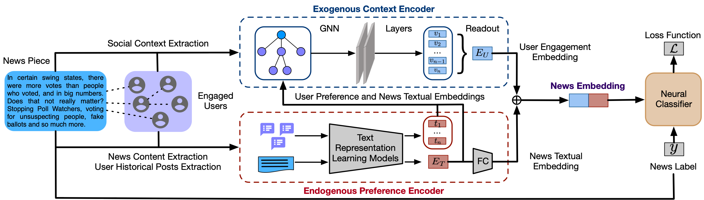

# Multimodal Fake News Detection Using Graph Neural Networks

A graph-based fake news detection system that leverages **Graph Neural Networks (GNNs)** to analyze the relationships between news articles and their associated social-media information for classifying potentially fake news.

## 📌 Overview

Fake news can spread rapidly through social-media platforms, making automated detection an important research problem. This project explores a graph-based approach where news articles and their social interactions are represented as interconnected structures and processed using Graph Neural Network architectures.

The project includes implementations of multiple GNN-based models for fake news classification and supporting utilities for data loading, feature processing, evaluation, and social-media data handling.



## 🎯 Objectives

- Detect fake and real news using graph-based learning.
- Represent relationships between news articles and social-media interactions.
- Explore Graph Neural Network architectures for fake news classification.
- Evaluate model performance using standard classification metrics.
- Provide a modular implementation that can be extended for further experiments.

## 🧠 Models

The repository contains implementations of several graph-based models:

- **GCN** — Graph Convolutional Network
- **GNN** — General Graph Neural Network implementation
- **BiGCN** — Bidirectional Graph Convolutional Network
- **GCNFN** — Graph Convolutional Network for Fake News detection
- **GNNCL** — Graph Neural Network based classification approach

## 📂 Project Structure

```text
Multimodal-Fake-news-Detection/
│
├── data/
│   ├── gos_news_list.txt
│   ├── pol_news_list.txt
│   └── ...
│
├── gnn_model/
│   ├── bigcn.py
│   ├── gcnfn.py
│   ├── gnn.py
│   └── gnncl.py
│
├── utils/
│   ├── data_loader.py
│   ├── eval_helper.py
│   ├── profile_feature.py
│   └── twitter_crawler.py
│
├── hyper_parameters.md
├── overview.png
├── requirements.txt
├── LICENSE
└── README.md
```

## ⚙️ Technologies Used

- Python
- PyTorch
- Graph Neural Networks
- Deep Learning
- Natural Language Processing
- Social Media / Twitter Data
- NumPy
- Scikit-learn

## 📊 Datasets

The project works with datasets containing news articles and associated social-media information.

The repository includes supporting files for datasets such as:

- **GossipCop**
- **Politifact**

Large raw datasets and model files are excluded from the repository where appropriate using `.gitignore`.

## 🚀 Getting Started

### 1. Clone the repository

```bash
git clone https://github.com/Sai28maddala/Multimodal-Fake-news-Detection.git
cd Multimodal-Fake-news-Detection
```

### 2. Create a virtual environment

```bash
python -m venv venv
```

Activate it on Windows:

```bash
venv\Scripts\activate
```

On Linux/macOS:

```bash
source venv/bin/activate
```

### 3. Install dependencies

```bash
pip install -r requirements.txt
```

### 4. Configure the dataset

Place the required dataset files in the appropriate `data/` directories.

Refer to the project configuration and `hyper_parameters.md` for the required parameters and dataset setup.

### 5. Run the model

The model implementations are available in:

```text
gnn_model/
```

and supporting data-processing and evaluation utilities are available in:

```text
utils/
```

Use the corresponding model/configuration files to run experiments.

## 📈 Evaluation

The project includes evaluation utilities for assessing classification performance.

Common evaluation metrics include:

- Accuracy
- Precision
- Recall
- F1 Score

The evaluation workflow is implemented in:

```text
utils/eval_helper.py
```

## 🔬 Research Focus

This project explores the application of **Graph Neural Networks for fake news detection**, particularly the use of relationships and propagation structures associated with news content.

Graph-based learning can capture information that may not be represented by analyzing the text of an article alone, making it useful for studying the propagation and interaction patterns surrounding online news.

## 🔮 Future Improvements

Potential extensions include:

- Incorporating richer textual representations using Transformer models.
- Adding multimodal information such as images and article text.
- Integrating newer social-media interaction features.
- Experimenting with modern Graph Transformer architectures.
- Deploying the trained model through a web API.
- Building an interactive dashboard for real-time predictions.

## 👩‍💻 Author

**Maddala Venkata Sailakshmi**

B.Tech — Computer Science and Engineering  
Woxsen University, Hyderabad

## 📄 License

This project is licensed under the terms of the license included in this repository.
